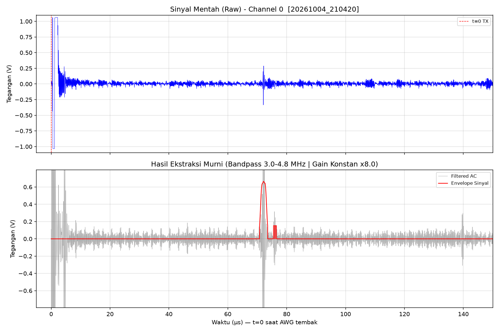

# Ultrasound Mass Flow

Sistem akuisisi dan pengolahan sinyal ultrasonik pulse-echo berbasis **Red Pitaya** untuk mendeteksi
pantulan dinding akrilik dan permukaan air di dalam pipa, mengukur *time-of-flight* (ToF), dan memetakan
profil penampang pipa dengan 16 transduser. Ini adalah bagian dari riset alat ukur *mass flow* ultrasonik.



## Cara kerja

1. **Eksitasi**: generator (AWG) Red Pitaya mengirim burst sinus 5 MHz (1 siklus, 1 V) ke transduser.
2. **Akuisisi**: ADC Red Pitaya merekam echo pada 62,5 MS/s (decimation 2), dipicu oleh AWG.
3. **DSP**:
   - bandpass Butterworth orde 8 (3,0–4,8 MHz) dengan `filtfilt` dan gain digital,
   - envelope lewat transformasi Hilbert lalu dihaluskan dengan moving average,
   - *noise gate* (threshold) dan *blanking* 2,5 µs pertama untuk membuang ringing transmit.
4. **Auto-zero**: puncak terkuat pada jendela 2,5–6,0 µs dianggap pantulan akrilik dan dijadikan titik 0 µs.
5. **Deteksi air**: puncak terkuat setelah +1,5 µs (relatif terhadap akrilik) dianggap permukaan air,
   dan waktunya menjadi **ToF air**. Data lebih dari 2,5 µs setelah puncak itu dibuang untuk
   menghilangkan pantulan ganda (reverberation).

## Skrip

| Berkas | Fungsi |
|---|---|
| [`massflo_single.py`](massflo_single.py) | Satu channel, sekali tembak. Menampilkan sinyal mentah dan envelope, lalu menyimpan `plot_visual_<waktu>.png` dan `hasil_visual_<waktu>.csv`. |
| [`massflo_single_rt.py`](massflo_single_rt.py) | Satu channel, real-time. Grafik diperbarui terus beserta ToF air. Hentikan dengan `Ctrl+C`. |
| [`massflo.py`](massflo.py) | Pemindaian 16 channel lewat multiplexer. Menampilkan waterfall profil pipa, lalu menyimpan `massflow_16ch_profile.png` dan `massflow_16ch_envelope.npy`. |
| [`redpitaya_scpi.py`](redpitaya_scpi.py) | Pustaka SCPI resmi dari Red Pitaya (pihak ketiga). |
| [`archive/`](archive/) | Versi-versi lama skrip (nama berkas = tanggal `DDMMYY_HHMM`) dan [`dokumentasi_plot/`](archive/dokumentasi_plot/) berisi hasil plot/CSV dari pengujian 30 Sep – 4 Okt 2026. |

## Perangkat keras

- Red Pitaya (STEMlab) dengan server SCPI aktif.
- Transduser ultrasonik ~5 MHz: OUT1 sebagai pemancar, IN1 sebagai penerima (gain LV).
- Media uji: dinding/wedge akrilik dan air.
- Khusus `massflo.py`: multiplexer 16 channel yang dikendalikan pin digital Red Pitaya
  - `DIO0_P`–`DIO3_P`: alamat channel (biner 4 bit, 0–15)
  - `DIO4_P`: diset `1` (enable)

## Instalasi

Butuh Python 3.9 atau lebih baru.

```bash
git clone https://github.com/alimxtar/ultrasound-massflow.git
cd ultrasound-massflow
pip install -r requirements.txt
```

## Penggunaan

1. Nyalakan Red Pitaya dan aktifkan server SCPI (web interface → Development → SCPI server).
2. Sesuaikan alamat Red Pitaya di bagian **KONFIGURASI** pada skrip:
   - `massflo_single.py` / `massflo_single_rt.py`: `IP_ADDRESS = 'RP-F0B91C.LOCAL'`
   - `massflo.py`: `IP = '169.254.66.156'`
3. Jalankan skrip yang diinginkan:

```bash
python massflo_single.py      # sekali tembak, simpan PNG + CSV
python massflo_single_rt.py   # real-time, Ctrl+C untuk berhenti
python massflo.py             # scan 16 channel
```

## Parameter utama

Semua parameter ada di bagian **KONFIGURASI** di awal tiap skrip.

| Parameter | Nilai | Keterangan |
|---|---|---|
| `FREQ_HZ` / `FREQ` | 5 MHz | Frekuensi burst |
| `N_CYCLES` / `BURST_CYCLES` | 1 | Jumlah siklus per burst |
| `AWG_VOLT` / `AMPL` | 1,0 V | Amplitudo eksitasi |
| `ACQ_DEC` | 2 | Decimation ADC (125 MS/s ÷ 2 = 62,5 MS/s) |
| `ACQ_DLY` | 8192 | Trigger delay (sampel) |
| `FILTER_LOW` – `FILTER_HIGH` | 3,0 – 4,8 MHz | Pita bandpass |
| `DIGITAL_GAIN` | 12 | Penguatan setelah filter |
| `MA_WINDOW` | 128 sampel | Lebar moving average envelope |
| `NOISE_THRESHOLD` | 0,15 | Envelope di bawah nilai ini dinolkan |
| `BLANK_US` | 2,5 µs | Durasi blanking awal |

## Lisensi

Kode di repositori ini dirilis di bawah [lisensi MIT](LICENSE), kecuali `redpitaya_scpi.py`
(© Red Pitaya) yang mengikuti lisensi aslinya.
